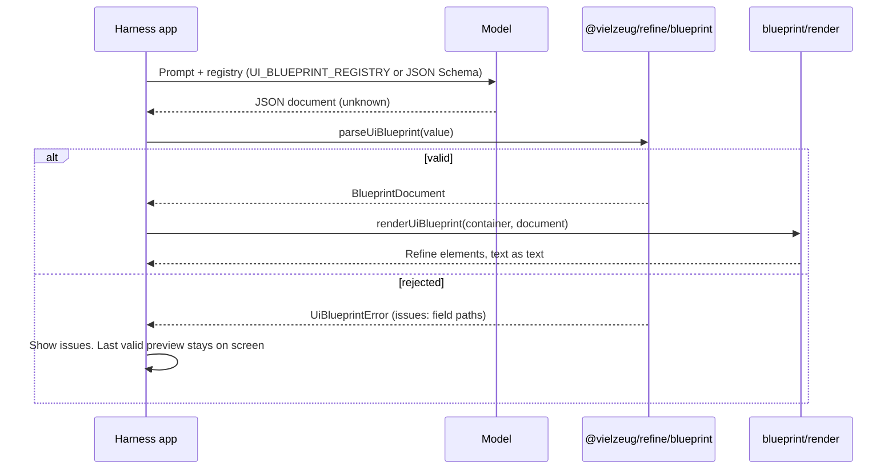

# On-Demand UI Documents

[[toc]]

An agent harness (Copilot, Claude, Codex, or your own) can generate small UI on request: "show me a summary card with the three risky deals." The model's output is untrusted input, and rendering untrusted input is how prompt injection becomes stored XSS. The blueprint entries exist so the model can *describe* UI while the application decides what gets *rendered*.



The split is deliberate: `@vielzeug/refine/blueprint` is pure data (no DOM, no component registration) so it can run anywhere, and `@vielzeug/refine/blueprint/render` is the only entry that touches the DOM.

## The Document Contract

A document is one object with exactly two fields:

```json
{
  "version": 1,
  "root": {
    "type": "card",
    "padding": "lg",
    "elevation": 1,
    "children": [
      { "type": "text", "text": "Quarterly pipeline", "variant": "heading", "as": "h2" },
      { "type": "text", "text": "Three deals need a next step before Friday." },
      { "type": "separator" },
      {
        "type": "box",
        "children": [
          { "type": "badge", "text": "Needs attention", "color": "warning" },
          { "type": "button", "label": "Review deals" }
        ]
      }
    ]
  }
}
```

Rules the contract enforces:

- **A fixed component set.** `type` is one of `text`, `box`, `card`, `button`, `badge`, `separator`, `slider`, `switch`, `checkbox`, `number-input`, `alert`, `progress`, `icon`. Anything else is rejected with the allowed list in the message.
- **Exact props per component.** Each component accepts only its documented fields, with only its documented values. There is no generic prop bag, and unknown keys are rejected at every level rather than ignored.
- **Children only where the component has a default slot.** `box`, `card`, and `alert` take `children`; leaves like `text` and `button` do not.
- **Presentational only.** A button carries a `label`, never an `href`, `target`, callback, or event. A generated control cannot navigate, route, or call into the host. Action wiring, when a product needs it, is host code outside this contract.
- **No styling surface.** No CSS, no class names, no inline styles, no URLs. Theme vocabulary (`color: "warning"`, `padding: "lg"`, `elevation: 2`) is the only aesthetic language, and it resolves to Refine tokens inside each component.
- **Bounded.** At most 64 nodes, depth 6, 12 children per container, 500 characters of body text, 120 characters of label, numeric fields finite and within ±1e9. Individual fields tighten that ceiling where the component would silently reinterpret an out-of-range value: a step must be positive (the components absorb `0` into their default), progress `value` is non-negative, and `segments` is a whole number. The basis for each number is documented beside the constant.

## Interactive UIs and Node Identity

The registry deliberately stops short of behaviour: a document describes what a UI looks like, never what it does. That is enough for a preview, but an interactive panel (a filter form, a what-if calculator) needs the host to *address* individual controls. That is what `id` is for:

```json
{
  "version": 1,
  "root": {
    "type": "box",
    "children": [
      { "id": "rate", "type": "slider", "label": "Interest rate", "min": 0, "max": 20, "step": 0.5 },
      { "id": "years", "type": "number-input", "label": "Term (years)", "min": 1, "max": 30 },
      { "type": "progress", "value": 35 }
    ]
  }
}
```

- `id` is optional, at most 64 characters, and unique across the document. Duplicates are rejected.
- `id` is **not** an attribute: the renderer never writes it to the DOM, so a model cannot forge `id`s into the page.
- `renderUiBlueprint()` returns a `Map<string, HTMLElement>` keyed by those ids, and the host wires real behaviour to the elements: state, listeners, data, tests.

```ts
const { element, nodes } = renderUiBlueprint(previewHost, value);
const rate = nodes.get('rate');
rate?.addEventListener('change', () => recalculate());
```

The split keeps both sides honest. Model output stays pure data with no behaviour, so nothing new can execute; the host keeps every handler, every piece of state, and every network call. Controls are interactive in the browser-native sense (a slider drags, a checkbox toggles) exactly as they are when you write them by hand; what the *document* can never do is decide what happens next.

Components with a required accessible name (`button`, `slider`, `switch`, `checkbox`, `icon`) reject a document that omits it, so no generated control can be unlabeled.

## Validating Model Output

Keep model output as `unknown` until `parseUiBlueprint()` returns. It collects every rejection before throwing, so one round trip tells the model everything wrong:

```ts
import { UiBlueprintError, parseUiBlueprint } from '@vielzeug/refine/blueprint';

let blueprint;
try {
  blueprint = parseUiBlueprint(JSON.parse(rawModelOutput));
} catch (error) {
  if (error instanceof UiBlueprintError) {
    // Each issue is a field path and a reason, for example:
    //   root.children[0].size: expected one of sm, md, lg, received string.
    // Feed error.issues straight back into the next prompt.
    retryWithFeedback(error.issues);
  }
}
```

Issues are safe to display: they name fields and allowed values, report a wrong-typed value only as its *type*, and echo an accepted-type value (a bad enum string, a rejected key) only as a truncated snippet. Nothing is copied into an issue unbounded, whatever the model put in the document. There is no repair mode. A document that needs a default filled in is a document the model should have written correctly, and silently guessing what it meant is how a UI ends up lying.

## Rendering

```ts
import { renderUiBlueprint } from '@vielzeug/refine/blueprint/render';

function showPreview(value: unknown): void {
  try {
    const { element, nodes } = renderUiBlueprint(previewHost, value, { label: 'Generated preview' });
    wireHostBehaviour(nodes); // real handlers live here, in host code
  } catch (error) {
    // previewHost is untouched: the last valid preview is still showing.
    showRejection(error);
  }
}
```

`renderUiBlueprint()` validates first and only then touches the container, so a malformed or stale response can never partially render or erase what is on screen. It returns `{ element, nodes }`: the rendered root and the id-keyed node map described above. The renderer is a fixed switch from node type to component: it sets literal attribute names from the validated node, inserts text with `document.createTextNode`, and has no code path that accepts markup, HTML strings, or callbacks. `javascript:alert(1)` as body text renders as the string `javascript:alert(1)`.

Importing `@vielzeug/refine/blueprint/render` registers the thirteen components it can create, so a harness does not import them individually. Pass `replace: false` to append instead of replacing, and omit `label` when the surrounding view already names the region.

## Driving a Model From the Registry

The registry is published as data so a harness can put it in a prompt without hardcoding a second copy of the truth:

```ts
import { UI_BLUEPRINT_JSON_SCHEMA, UI_BLUEPRINT_REGISTRY } from '@vielzeug/refine/blueprint';

// Structured-output / tool-use APIs take the schema directly:
const response = await model.create({
  response_format: { json_schema: { schema: UI_BLUEPRINT_JSON_SCHEMA } },
  // ...
});

// Prose prompts can render the registry instead:
for (const [name, rule] of Object.entries(UI_BLUEPRINT_REGISTRY)) {
  prompt += `${name} -> <${rule.tag}> attributes: ${rule.attributes.join(', ')}\n`;
}
```

`UI_BLUEPRINT_JSON_SCHEMA` (draft 2020-12) mirrors the contract with `additionalProperties: false` everywhere, which steers a model away from inventing props. It cannot express the tree-wide node and depth bounds, so it is a generation aid, never the trust boundary: validate everything with `parseUiBlueprint()` regardless of how the JSON was produced.

## Failure Handling

| Failure | What happens | What the harness shows |
| --- | --- | --- |
| Invalid JSON | Never reaches the contract (`JSON.parse` throws first) | "The model did not return valid JSON." |
| Rejected document | `UiBlueprintError`; container untouched | The `issues` list, and the previous preview |
| Unknown component | Rejected with the registered list | Same |
| Over budget | Rejected with the budget rule | Same; prompt the model for something smaller |

The UI never shows a half-rendered document, and it never silently keeps a stale one: mark the preview stale in your own state when a request starts, and clear it only when a valid document renders.

## Best Practices

- **Treat model output as `unknown`.** Parse, then validate, then render. Never cast.
- **Render rejections visibly.** `issues` are written to be displayed and fed back.
- **Keep actions host-side.** A blueprint describes what a UI looks like; buttons in it are inert by design. Give addressable controls an `id` and wire behaviour from the returned node map.
- **Regenerate, don't repair.** Send the issues back to the model instead of patching documents in application code.
- **Pin the version.** Documents carry `version: 1`; reject anything else rather than guessing forward.

## What the Registry Leaves Out

Every exclusion is a surface that cannot be verified as pure data, and each has a host-side answer:

| Left out | Why | Host-side answer |
| --- | --- | --- |
| `href` / `src` anywhere | A model-invented URL is a phishing or exfiltration vector | The host maps a validated label to a URL it owns |
| `datagrid`, `combobox`, `chat-panel` | Their props carry function values (`getRowKey`, `upload`, `ref`) | The host renders these itself; blueprint covers the surrounding layout |
| `select`, `tabs`, `table` | Sub-vocabularies (`option`, `tab`, `th`/`td` markers) the contract does not model yet | Host fills the region, or wait for a registry addition |
| Charts | `prism` is not a Refine dependency | Render a `box` with an `id`; the host mounts its chart into that element |
| `speech-player`, `qr-scanner`, `cookie-banner` | Ambient browser capabilities and persistent consent state | Never model-triggerable; host code only |

Widening the registry is additive: a component joins with a validated rule, a renderer case, and a drift-guard test that pins its attributes to the real component source. Components whose props cannot be expressed as bounded data stay out.
